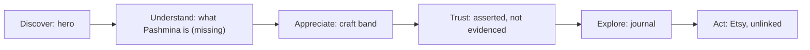

# HOUSE OF KANI — PRODUCT & CONTENT AUDIT

**Scope and method.** I read the source of all 14 routes, the 5 journal articles, the shared header, footer and editorial components, the content modules (`src/lib/site.ts`, `src/lib/journal.ts`), all 19 image files and the repository history (including the Lovable `roadmap.md`). I did not change anything. I did not open the live site in a browser, so notes about mobile come from the responsive code, not from screenshots.

**Evidence labels used below**
- **Fact:** something I checked in the code, the images or the repository.
- **Observation:** what a reader sees on the page.
- **Inference:** what a visitor will probably conclude.
- **Recommendation:** a change in direction. These are not rewrites.
- **UNVERIFIED CLAIM:** a statement the site makes that nothing in the material supports.

---

## 1. Executive Summary

**Short answer:** No. The site does not yet explain House of Kani clearly enough for a first-time visitor. Within a few seconds, a visitor sees that it is a refined Kashmiri brand with some connection to Pashmina. Even after exploring the whole site, they still cannot say what Pashmina is, what House of Kani sells, who runs it, or why they should trust it.

1. **The brand's best idea is a promise the site does not keep.** It presents House of Kani as "a house devoted to the truth of Pashmina" and says "Knowledge Protects What Is Genuine". That is a strong, distinctive position. But no page states plainly what Pashmina is, what "authentic" means, or how to recognise a genuine piece.
2. **The Pashmina page never defines Pashmina, and neither does the homepage (Fact).** The nearest thing to a definition is one line on the Craftsmanship page ("The finest inner down of the Changthangi goat") and a 150-word journal essay.
3. **The offer is unclear.** The word "shawl" appears nowhere on the homepage or the Pashmina page (Fact). It appears once, on The House page. The site gives no product forms, sizes, fibre composition, price level or launch date.
4. **It is unclear what kind of business this is.** The site calls itself a "knowledge and brand platform", a "house", a "digital maison" and an "atelier", and mentions "salons". It never says whether House of Kani weaves, commissions, sources or curates. No founder, team member or artisan is named anywhere (Fact).
5. **The basic trust details are placeholders or don't work (Fact):**
   - A code comment marks the contact details as placeholders, yet the Atelier address is shown on the Contact page and published in the search-engine data.
   - All three social links point to `#`.
   - The enquiry form shows "Your note has been received" but sends nothing.
6. **The services described contradict the launch plan.** The site mentions London and Srinagar salons, "appointed partners", a private-client service, bespoke commissions and a press page — all UNVERIFIED. It also says "coming first to Etsy". The two positions conflict.
7. **The imagery is the biggest credibility risk for a brand that sells authenticity:**
   - The repository roadmap records that "original generated imagery" replaced the photographs supplied by the owner (Fact).
   - The 19 image files contain only 14 distinct pictures (Fact). One shawl photo appears in 10 places. The loom picture appears 3 times on the homepage alone.
   - A sepia lake picture is labelled "Archival view of Dal Lake" in its alt text (the text description used by screen readers and search engines).
8. **The site leans heavily towards Kani, but the business is about Pashmina in general.** The Heritage, Kashmir, The House, Private Client and Press pages all frame the brand around Kani. Sozni and solids get one paragraph each and no page of their own.
9. **Luxury comes from atmosphere, not substance.** To its credit, the copy avoids the words "luxury" and "exclusive". It replaces them with poetic abstraction:
   - About 20 sentences use a "not X, it is Y" construction.
   - "Memory" appears 13 times and "intelligence" 7 times.
10. **There is not much content behind the presentation.** Each journal essay is about 130–200 words but is labelled as a "5–9 min read" (Fact).
11. **Heritage is asserted, not shown.** The timeline lists centuries but names no people, places or sources. It then adds House of Kani, a brand that has not launched, as "The next chapter".
12. **Visitors have nowhere clear to go next.** Etsy is mentioned 3 times and linked 0 times (Fact). The homepage has eight differently worded arrow links, all with equal weight, and no main action.
13. **There is a solid base to build on:**
    - The model "Pashmina is the material. The making gives each piece its character."
    - The step-by-step explanation on the Kani page.
    - The short, clear definitions of Sozni and solids.
    - A tone that is restrained and consistent.

**Overall:** The site reads as a mood piece about Kashmiri textile culture, not as an introduction to a Pashmina brand. The tone and page structure are usable. What's missing is substance, evidence, and honesty about where the business stands today.

---

## 2. Current Brand Understanding

**What the site is trying to communicate (inference from repetition):** "House of Kani is a respectful, knowledge-led keeper of Kashmiri Pashmina culture." The tagline "From Kashmir, woven for the world" appears 7 times in the source. A "Who We Are" section appears twice. Three pages explain why a brand named Kani covers all Pashmina.

**What the site seems to treat as its main message:** craftsmanship and cultural reverence. A first-time visitor needs basic orientation first: what this is, what it sells, and why they should care.

| Time | What a new visitor probably understands | What they don't |
|---|---|---|
| **5 seconds** | A Kashmiri Pashmina brand with an upscale feel. The gold label "Authentic Pashmina · Kashmir" works: it states the category and the origin. The hero photo suggests shawls. | What Pashmina is. Whether anything is for sale. What "Kani, Sozni and solids" means: the first line of copy puts three unfamiliar terms in front of a beginner. |
| **30 seconds** | From the "Who We Are" and "What We Offer" sections: the brand talks about Pashmina, its name refers to a weaving tradition, and there are three styles. | What Pashmina is made from. Whether this is a shop, a magazine or a maker. The word "platform" may suggest a marketplace or a media site. |
| **2 minutes** | After the craft section, "Why House of Kani", the journal and the Etsy band: the brand values slowness and skill, and a first collection is coming to Etsy. They may realise the brand has not launched. | Who is behind it. What the pieces cost. When the collection launches. How "authentic" is guaranteed. |
| **Full exploration** | Pashmina comes from goat down. Kani is woven with small bobbins that follow a coded pattern (the talim). Sozni is hand embroidery on finished cloth. Solids are plain. A loose outline of the history. | Founder, makers, sourcing, how to verify a piece, price level, launch date, care. They also find contradictions: Etsy versus London salons; a knowledge platform versus "returning to the loom". |

**Still unclear after full exploration:**
- whether House of Kani makes, commissions or curates its pieces
- who runs it
- what the pieces physically are (shawl, stole or wrap; size; fibre content)
- whether the pieces are new or antique
- what makes a House of Kani piece different from any other Kashmiri Pashmina
- when and where a visitor can buy one

---

## 3. Core Communication Problems

**P1. Pashmina is not explained where visitors look for an explanation (Critical)**
- **Evidence:** The homepage says "Pashmina is the material" and never says what the material is. The `/pashmina` page is titled "One Fibre. Many Expressions." and covers techniques only. The words "cashmere", "handwoven", "hand-spun", "blend", "silk" and "machine" each appear zero times (Fact).
- **Impact:** The core business question fails. A beginner leaves without knowing what they would be buying or why it is valuable.
- **Direction:** Give a plain, specific definition early on the homepage. Make `/pashmina` the main explanatory page (a hub) for Pashmina before it covers techniques.

**P2. The business and its people are invisible (Critical)**
- **Evidence:** The site describes itself as a "knowledge and brand platform", a "digital maison", an "atelier" and "salons". No person is named anywhere, and there is no founding story.
- **Impact:** Luxury buyers trust people and accountability. A brand without a face that sells "authenticity" invites suspicion.
- **Direction:** State plainly what House of Kani does in the chain (makes, commissions, sources or curates), who is behind it, and how it works with makers.

**P3. Unverified operational claims and broken trust details (Critical)**
- **Evidence:**
  - `src/lib/site.ts` contains the comment "Placeholder details — replace with the maison's real particulars", covering the emails, phone number, Atelier address and studio.
  - The social links are `href="#"`.
  - `EnquiryForm` only changes what is shown on screen. It never sends anything.
  - The Stockists, Private Client and Press pages describe services and assets that don't exist yet.
- **Impact:** A research-minded visitor who checks any one of these will lose trust in everything else on the site. The form actively loses leads while telling visitors the House "will be in touch".
- **Direction:** Show only what is true today. Take down or hide services that don't exist yet. Make contact work, or remove the form.

**P4. Imagery authenticity and repetition (Critical)**
- **Evidence:**
  - The roadmap lists "Add generated imagery" and "Replace direct use of supplied reference photographs with original generated imagery" as done (Fact).
  - The file `kani-pattern.jpg` is byte-identical to `craftsmanship-hall.jpg`, `private-client.jpg` and `closing-drape.jpg`. `kani-loom.jpg` is identical to `journal-artisan.jpg` and `journal-workshop.jpg`. `pashmina-fibre.jpg` is identical to `threads.jpg` (Fact, checked with checksums).
  - The same shawl is described in alt text as "macro detail", "by candlelight", "in a private salon" and "contemporary presentation".
  - The "Pashmina fibre" image shows no raw fibre, only a folded patterned cloth and spools of thread.
- **Impact:**
  - Inference: A Pashmina-aware visitor will notice the same image over and over.
  - Inference: A visitor who recognises a generated image will doubt every claim of "authentic", "genuine" and "master artisan".
  - Labelling a generated picture as "Archival" misrepresents it.
- **Direction:** Use real photographs of real pieces, real makers and real fibre, with accurate captions. Use fewer images rather than generated or repeated ones.

**P5. "Authentic" is claimed but never defined or backed up (High)**
- **Evidence:** "Authentic" appears in the hero label, the homepage title, the "Who We Are" text, the Etsy band and an image's alt text. No page explains what makes a piece authentic, how House of Kani checks it, or how a buyer could check it. The site mentions no GI (Geographical Indication, a legal mark of regional origin) or any certification (Fact). Whether any House of Kani piece holds such a mark is not stated anywhere, and I could not verify it.
- **Impact:** The brand's reason to exist is to help people recognise what is genuine, and that remains an empty statement.
- **Direction:** Add an explanation of authenticity: what the word means here, what House of Kani discloses about each piece, and which certifications apply (only if they really do).

**P6. Kani dominates a business that covers all Pashmina (High)**
- **Evidence:**
  - Heritage page: "The story of Kani is carried in cloth…" and the timeline "knowledge of Kani … old intelligence of Kani".
  - Kashmir page: its search description says "the origin of Kani".
  - Private Client page: "integrity of Kani".
  - Press page: "cultural memory of Kani weaving".
  - Kani is mentioned 143 times in the source and Sozni 20 times (Fact).
  - Sozni and Solids have no page of their own. Both homepage cards link to the same `/pashmina` page.
- **Impact:** Visitors will assume House of Kani sells Kani shawls only. That contradicts the business and leaves the other product lines without support.
- **Direction:** Treat Kani as the brand's namesake and its benchmark for standards, not as its whole scope. Give each technique equal depth.

**P7. The hero leads with the brand name and jargon, not a value proposition (High)**
- **Evidence:** The headline is "House of Kani". The line below it reads "Kani, Sozni and solids — understood through the hands, histories and traditions that make them."
- **Impact:** The first full sentence asks a beginner to decode three terms. "Understood through" frames the site as education, not as a brand offering pieces. The specific line "From Kashmir, woven for the world" is hidden on mobile (`hidden sm:block`).
- **Direction:** The first screen should answer, in plain terms, what this is, what it offers and why it is different, then offer one clear next step.

**P8. Poetic abstraction takes the place of information (High)**
- **Evidence:** Roughly 20 sentences follow the pattern "X is not Y. It is Z.", for example "Time Is Not Hidden. It Is the Measure.", "Kashmir Is Not a Reference. It Is the Origin." and "Months are not a production cost here. They are a material." Words such as "memory", "intelligence", "rhythm" and "living" repeat across pages.
- **Impact:** Read one at a time, the lines sound premium. Read together, they feel templated, which works against "authenticity". They also take up the space where facts should be.
- **Direction:** Keep one poetic line per section at most, and anchor it with specifics.

**P9. No clear next step or route to buy (High)**
- **Evidence:** Etsy appears as plain text in three places: the homepage band, the mobile menu and the footer. There is no link and no date (Fact). The homepage has eight arrow links with different wording: "Discover Pashmina", "Read Our Story", "Understand the Traditions", "Meet the Making", "Explore the Heritage", "Enter the Journal", "Enter the House", "Speak with the House". None stands out as the main action.
- **Impact:** Interested visitors reach a dead end. No visitor details are captured before launch either, because the form doesn't work.
- **Direction:** Set one consistent main action (understand, then find where to buy) and a single honest "Where to buy" destination.

**P10. Heritage is asserted without evidence (Medium)**
- **Evidence:** The Heritage timeline runs "15th century", "17th–18th century", "under royal patronage", with no names, places or sources. It ends with "House of Kani — The next chapter".
- **Impact:** A research-oriented visitor will read this as generic. Placing a brand that has not launched inside 600 years of history reads as overreach.
- **Direction:** Use specific heritage content with sources, or less heritage content. Separate the history of the craft from the story of the brand.

---

## 4. Pashmina Education Audit

**Where the Pashmina explanation actually sits (Fact):**
- **Homepage:** "Pashmina is the material. The making gives each piece its character." This is a good mental model, but it never says what the material is.
- **`/pashmina`:** no definition. The page covers techniques only.
- **`/craftsmanship`:** "The finest inner down of the Changthangi goat: light, warm and almost impossibly soft." This is the only plain fact on the site.
- **Journal, "The Story of Pashmina":** inner down of the Changthangi goat, gathered by hand in spring, then cleaned, spun and woven in the valley. About 150 words.
- **The House and Kashmir pages:** "warmth gathered from a high-altitude winter" and "arrives from high ground". These are atmosphere, not information.

**What a beginner understands:** Pashmina is soft, light and warm, comes from somewhere high and cold, and is made into cloth in Kashmir by hand.

**What stays unclear or missing:**

| Topic | Current state |
|---|---|
| Definition (fibre vs cloth vs shawl) | Missing on the main pages |
| Origin of the fibre | Vague ("high ground", "far above the valley"). The region is never named. |
| How it differs from wool or cashmere | Missing. "Cashmere" appears zero times, yet it is the term most luxury buyers already know. |
| Pure vs blended; hand-spun vs machine-spun; handwoven vs power-loomed | Missing. These are the distinctions that explain price and authenticity. |
| Why "Pashmina" is "often misunderstood" | Hinted at on the homepage, never explained |
| What makes it valuable | Asserted ("rare fibre") but not explained |
| "Fineness" | Used as a heading ("Fineness Before Form") with no meaning or measure given |
| Care and longevity | Missing, although "heirloom" and "generations" are claimed |
| GI / certification | Absent. Relevant only if it really applies. |

**What a premium customer actually needs to understand (conceptually):**
1. What Pashmina is, in one sentence.
2. Where it comes from and why the place matters.
3. How fibre becomes cloth, and which steps are done by hand.
4. Why prices vary so widely (purity, spinning, technique, time).
5. How the word is misused in the wider market.
6. What House of Kani tells buyers about each piece.
7. How to care for it.

**Jargon map**

| Term | First appears | Explained? | Recommendation |
|---|---|---|---|
| Pashmina | Hero | No (home, `/pashmina`) | Explain on the page where it appears, and on a dedicated page |
| Kani | Hero, brand name | Partly ("Pattern woven into the cloth") | Add a one-line explanation where it appears, linked to `/kani` |
| Sozni | Hero | Adequately on its card | Keep |
| Solids | Hero | No. "Fibre, colour and drape revealed" never says plain or unpatterned. | Replace with plainer wording, or add a short explanation |
| Talim | Homepage craft band | Only on `/kani` | Remove from the homepage, or explain it where it appears |
| Boteh | Kani page, Heritage, Journal | Never in visible text. Only the alt text says "paisley". | Explain where it appears; "paisley" is the familiar anchor |
| Changthangi goat | Craftsmanship | Partly (where the goats live is not stated) | Explain on the Pashmina page |
| Warp / weft | Kani, Craftsmanship, Journal | No | Keep on the deep-dive pages with a short explanation |
| Persianate, chinar | Kani, Craftsmanship | No | Explain them or simplify |
| Atelier, maison, salon | Several pages | No. These imply physical premises. | Keep only if they are real |
| Authentic, genuine | Hero, homepage | Never defined | Give them their own section |
| Artisan, master | Several pages | No person is named | Tie to real people, or use less |
| Heirloom | Craftsmanship | No | Keep only with care and durability information |

---

## 5. Luxury Positioning Audit

| Dimension | Status | Evidence |
|---|---|---|
| Craftsmanship | Partly present | Kani process explained well; Sozni gets one paragraph; nothing specific to House of Kani (which piece, who made it, how long it took) |
| Rarity | Unsupported | "Rare fibre", "rarest weaving traditions", "A Weave Without Equal": superlatives with no quantities or reasons |
| Provenance | Weak | Kashmir is repeated as the origin; the fibre's region is never named; House of Kani's own supply chain is absent |
| Authenticity | Unsupported | Claimed 5 or more times, defined 0 times |
| Heritage | Weak | Atmospheric timeline with no names or sources |
| Expertise | Weak | Claimed ("knowledge platform"), shown only on `/kani` |
| Trust | Absent, currently harmful | Placeholders, links to `#`, a form that sends nothing, unverified services |
| Material quality | Weak | One line about the fibre |
| Attention to detail | Weak | Repeated images, inflated read times, an empty "Heritage" journal filter, alt text that doesn't match the images |
| Restraint | Strong in vocabulary, weak in claims | "Luxury" appears once, and only to reject it as a claim. Services and history are overstated. |
| Differentiation | Weak | The positioning idea is distinctive; nothing in the execution is |
| Storytelling | Weak | Tone is consistent, but there are no people and no stated reason the brand needs to exist |

**The Etsy tension (observation and inference).** Etsy is a broad marketplace. "Private client", "collectors", "London salons" and "maison" describe a high-touch house. Visitors who know luxury will probably read the combination as inconsistent. Recommendation: don't hide Etsy. Present it honestly as the launch channel, and let the website itself carry the brand's authority through product information, provenance and people.

---

## 6. Product / Offer Clarity

> Can a first-time visitor clearly understand what House of Kani sells? **Only partly.**

**What a visitor can identify:** three families: Kani (woven pattern), Sozni (hand embroidery) and solids (plain colour).

**What a visitor cannot identify:**
- **Form:** shawl, stole, scarf or wrap? "Shawl" is never used on the homepage.
- **Fibre content:** "pure solids" could mean pure fibre or plain colour.
- **New or antique:** heritage language, "collectors" and "a rare Kani Pashmina in a private salon" could suggest antiques.
- **Who makes the pieces:** House of Kani, partner workshops or sourced artisans?
- **How many pieces, which sizes, what price level.**
- **Whether anything exists yet:** only the Etsy band says "Coming first", with no date.

The homepage's "What We Offer" section shows techniques, not pieces. Even on an informational site, a visitor expects to see the actual objects.

---

## 7. Brand Story & Differentiation

**The current story, as I can reconstruct it:** "A house rooted in Kashmir, named after Kani, that makes the fibre, technique and human skill of Pashmina visible so that what is genuine can be recognised, and that will bring pieces to the world, first via Etsy."

**The current narrative progression:**



The sequence exists in outline. Two stages fail: Understand is skipped, and Trust is asserted rather than shown.

**Missing story elements:**
- who founded it and why
- the moment or problem that prompted it (the misuse of "Pashmina" is hinted at but never told)
- its relationship with the makers
- what House of Kani does differently in practice
- what it refuses to do
- what it actually makes

**Generic language that any Kashmiri textile seller could use:** "From Kashmir, woven for the world"; "A Heritage That Endures"; "living tradition"; "The Hand Remembers"; "A museum of colour"; "A Weave Without Equal"; "Many Traditions. One Measure of Integrity."

**Opportunities to differentiate.** Each depends on facts the owner can confirm:
- **Become the brand that explains.** Disclose the technique, fibre, making region and approximate making time for every piece. This turns "Knowledge Protects What Is Genuine" from a slogan into practice.
- **Use the name as a statement of standard.** Present Kani as the benchmark the house measures itself against, not as the only thing it sells.
- **Teach buyers how to recognise a genuine piece.**
- **Name the makers,** with their consent.

---

## 8. Information Architecture

**What the current structure does.**
- **Header (7 links):** The House, Pashmina, Craftsmanship, Heritage, Journal, Kashmir, Contact.
- **Footer only:** Kani, Press, Privacy, Terms.
- **Reachable only by a link inside another page:** Private Client (from The House).
- **Not linked from anywhere:** Stockists (it is listed only in the sitemap) (Fact).

The site is organised by theme (place, heritage, craft) rather than by the questions a visitor actually has.

**Where it works:**
- `/kani` works well as a deep dive.
- The journal is a sensible home for editorial content.
- Page templates are consistent.

**Where it breaks:**
- The "Pashmina" nav link leads to techniques, not a definition.
- Kani is not in the header but Kashmir is.
- Sozni and Solids have no destination of their own.
- There is no "Where to buy", FAQ, Care or Authenticity page.
- The Heritage, Kashmir and The House pages overlap:
  - All three cover "Kashmir as origin".
  - Both The House and Heritage have a "Living Archive" section.
  - All three revisit Kani.
- Three hero sections use the same image: Home, The House and Pashmina.

**Introduce earlier:**
- what Pashmina is
- what the pieces are
- who is behind the brand
- the honest launch status

**Move later:**
- the Heritage timeline
- the Kashmir landscape content
- the Private Client service, until it is real

**Separate out:**
- Sozni and Solids into their own sections or pages
- Authenticity and how to recognise a genuine piece
- Where to buy

---

## 9. Content Audit

**Strongest content**
- The homepage "What We Offer" model: Pashmina is the material, and the making gives each piece its character.
- The Kani page's five-part list (origins, talim, bobbins, pattern, time) and the line "Unlike embroidery, every motif is formed during weaving itself."
- The Sozni and Solids definitions on `/pashmina`.
- The list of craft roles on the Kashmir page: spinner, dyer, designer, talim writer, weaver.
- The positioning line "Knowledge Protects What Is Genuine."

**Weakest content**
- The `/kashmir` page: four landscape and culture vignettes, close to zero information.
- The Heritage timeline.
- The Craftsmanship list. Steps 4, 8 and 9 ("The Hands", "The Time", "The Heirloom") are abstractions rather than steps. Real stages are missing, such as sorting, dyeing, washing and finishing.
- The Press page, which implies coverage and an image library that don't exist.
- The journal articles: roughly 130–200 words each, labelled 5–9 minute reads.

**Repetitive content**
- The tagline (7 times).
- "Who We Are" (homepage and The House).
- The explanation of why the brand is named Kani (3 pages).
- "Kashmir as origin" (3 pages).
- The image repetition described in P4.

**Unclear content**
- "Knowledge and brand platform".
- "Beautifully finished solids".
- "Other expressions of the cloth".
- "Beyond the Three: … House of Kani will introduce these traditions carefully". This is a placeholder for future content.

**Missing content:** a definition of Pashmina, the business model, the people, actual pieces, authenticity, care, an FAQ, where to buy, a launch date.

**Unsupported claims**

| Claim | Location |
|---|---|
| "The Atelier, Zaina Kadal, Srinagar": UNVERIFIED CLAIM (marked as a placeholder in code; also published in search-engine data) | Contact, `organizationLd` |
| "Srinagar · London" private presentations; "a small circle of considered salons"; "appointed partner near you": UNVERIFIED CLAIM | Stockists |
| Private viewings, bespoke commissions, hospitality and interior projects: UNVERIFIED CLAIM | Private Client, enquiry form |
| "Every enquiry is … answered personally" (the form sends nothing) | Contact |
| An interview with an unnamed "master weaver", presented as reportage: UNVERIFIED CLAIM | Journal, "A Language Woven in Thread" |
| "One of the world's most intricate weaving traditions" / "A Weave Without Equal" / "one of Kashmir's rarest": UNVERIFIED CLAIM | The House, Kani, Pashmina |
| Heritage dates and "royal patronage" with no sources: UNVERIFIED CLAIM | Heritage |
| "House of Kani honours the archive by returning to the loom" and "Our palette … colour is chosen" both imply House of Kani produces its own pieces: UNVERIFIED CLAIM | Heritage, Craftsmanship |
| "Recognise the artisans whose knowledge sustains them" (no artisan is named) | The House |
| "Ready … for a life measured in generations": UNVERIFIED CLAIM | Craftsmanship |
| "Archival view of Dal Lake" (alt text on what appears to be a generated image) | Heritage |
| "The House in Print", "Image Library", "Brand Notes" | Press |

---

## 10. Audience Audit

**A. Pashmina beginner**
- **Works:** The mood is inviting, and the material-versus-technique model helps.
- **Missing:** A definition, a comparison with cashmere or wool, and what the products are.
- **Friction:** Three unfamiliar terms in the hero, plus "talim" on the homepage without explanation.
- **Builds trust:** The calm, non-pushy tone.

**B. Luxury consumer**
- **Works:** The visual restraint and the absence of sales language.
- **Missing:**
  - who is behind the brand
  - real product photography
  - specific materials
  - a reason this brand matters more than others
- **Friction:**
  - repeated images
  - generic poetic lines
  - Etsy alongside "private salons"
  - social links that go nowhere
- **Builds trust:** Not yet.

**C. Pashmina-aware customer**
- **Works:** The Kani page has real technical content.
- **Missing:**
  - fibre content and spinning method
  - handloom versus power loom
  - time ranges for specific pieces
  - GI status, if it applies
  - how Sozni and solids pieces are sourced
- **Friction:**
  - Inference: they are likely to spot generated imagery.
  - The loom scene shows a style of loom whose accuracy an expert may question.
  - "Pure" is never defined.
- **Builds trust:** Correct use of terms such as talim and kani.

**D. Research-oriented visitor**
- **Works:** Nothing they can verify.
- **Missing:**
  - sources
  - a legal entity
  - a real address
  - named people
  - a press record
  - certifications
- **Friction:**
  - placeholders
  - the form that sends nothing
  - read times that don't match the article length
  - an unnamed interview subject
- **Builds trust:** Currently, the site has a net negative effect on trust for this visitor.

---

## 11. Customer Questions Matrix

| Customer question | Answered? | Where? | Quality | Gap |
|---|---|---|---|---|
| What is Pashmina? | Partly | Craftsmanship (1 line), Journal | Weak | Missing from the home and Pashmina pages |
| Why is it valuable? | No | — | — | No explanation of the value |
| Where does it come from? | Vaguely | Craftsmanship, Journal | Weak | The region is never named |
| How is it different from cashmere or wool? | No | — | — | Absent |
| What is House of Kani? | Partly | Home, The House | Vague | Maker, curator or platform? |
| Who is behind it? | No | — | — | No people at all |
| What does it sell? | Partly | Home, The House | Weak | No forms, pieces or specifications |
| What is Kani? | Yes | `/kani`, home card | Good | Missing from the hero |
| What is Sozni? | Yes, briefly | `/pashmina` | Adequate | No depth or page |
| What is a "solid"? | Barely | `/pashmina` | Weak | Never says "plain" |
| What does GI mean / is it certified? | No | — | — | Absent |
| How can I tell it is authentic? | No | — | — | The brand's core promise is unaddressed |
| How is it made? | Partly | Craftsmanship, Kani | Medium | Missing stages; nothing specific to House of Kani |
| How long does it take? | Vaguely | Kani, Sozni, Journal | Weak | "Months and years", unsourced |
| Who makes it? | No | — | — | Anonymous "master" |
| What makes one Pashmina different from another? | Partly | `/pashmina` | Medium | Technique only, nothing on fibre or quality |
| How do I care for it? | No | — | — | Absent |
| Can I buy it? Where? When? | Barely | Etsy band | Weak | No link, no date |
| How much does it cost? | No | — | — | Not even a price level |
| How do I contact them? | Seemingly | Contact | Broken | The form doesn't send; emails are placeholders |

---

## 12. Page-by-Page Findings

### Homepage

**Sections in order (Fact).**

| Section | Current purpose | Actual message | Visitor question answered | Problem | Recommendation |
|---|---|---|---|---|---|
| Header | Navigation | Seven themes, no "Where to buy" | "What can I explore?" | Organised by theme; Kani missing | Revisit in the UI/UX audit |
| Hero | Identity | Brand name and three techniques | Category and origin (via the label) | No value proposition; jargon first | State what it is and why it matters, with one action |
| Who We Are | Introduction | "Knowledge and brand platform" | "Who are you?" (vaguely) | Type of business unclear; no people | Describe the business plainly |
| What We Offer | Offer | Three techniques | "What styles?" | Techniques, not pieces; two cards lead to the same page | Show real pieces, explained |
| Craftsmanship band | Appreciation | Slowness, by hand | "Is it handmade?" (implied) | Uses "talim" without explanation; abstract | Specific process facts |
| Why House of Kani | Differentiation | Knowledge protects the genuine | "Why you?" | Asserted, not shown | Back it with proof of what is disclosed |
| Journal | Authority | Three essays | "Do they know their subject?" | Thin essays; loom image shown twice | Lead with educational pieces |
| Etsy band | Next step | Coming to Etsy | "Can I buy?" | No link, no date; placed near the end | Make it an honest, linked "Where to buy" |
| Closing | Emotional close | Tagline again | — | Repetitive; "Enter the House" duplicates "Read Our Story" | Merge or remove |
| Footer | Utility | Descriptor and Etsy note | — | Social links go to `#` | Real links or none |

**Expected sections the homepage doesn't have:** a Pashmina explanation, real products or a collection, trust and credibility, a working call to action. The 11-part sequence you asked me to check has four empty slots.

### Every other page

**The House** (`/the-house`)
- **Purpose:** the "about" page.
- **Primary visitor question:** "Who are you?"
- **Current message:** reverence for Pashmina, Kani and Kashmir.
- **Clarity:** low.
- **Depth:** thin. Five sections of about 40 words each.
- **Trust:** no people.
- **Missing:** founder, business model, how the brand works with makers.
- **Unnecessary:** "Why Kani", which repeats `/kani`.
- **Major problem:** this is the only place that says "shawls", and it still doesn't say who is behind the brand.
- **Priority:** Critical.
- **Change:** make it the factual identity page.

**Pashmina** (`/pashmina`)
- **Purpose:** the main page explaining Pashmina.
- **Primary visitor question:** "What is Pashmina?"
- **Current message:** three techniques.
- **Clarity:** good on techniques, absent on the material.
- **Depth:** shallow.
- **Problems:** the Sozni image is used twice; "Beyond the Three" is a placeholder.
- **Priority:** Critical.
- **Change:** start with the material, then cover the techniques, with equal depth for each.

**Kani** (`/kani`)
- **Purpose:** explain the technique.
- **Clarity and depth:** the best on the site.
- **Missing:** how to tell real Kani from machine-woven imitations, time ranges, House of Kani's own Kani pieces.
- **Unnecessary:** the poetic hero line "A museum of colour".
- **Major problem:** the same loom image appears three times on this page's journey.
- **Priority:** Medium.
- **Change:** add specifics and use it as the template for Sozni and Solids pages.

**Craftsmanship** (`/craftsmanship`)
- **Purpose:** explain the process.
- **Clarity:** medium.
- **Problem:** the list mixes real steps with abstractions; dyeing and finishing are missing; claims such as "Our palette" are UNVERIFIED.
- **Priority:** High.
- **Change:** a factual process, from fibre to finished piece, separating general facts from House of Kani's own practice.

**Heritage** (`/heritage`)
- **Purpose:** credibility through history.
- **Clarity:** low.
- **Problem:** no sources; Kani-only; the brand inserted as "the next chapter"; the "archival" image appears to be generated.
- **Priority:** Medium.
- **Change:** specific history with sources, or merge into the Kashmir page or the journal.

**Kashmir** (`/kashmir`)
- **Purpose:** sense of place.
- **Depth:** very low. The craft-roles section is the only fact.
- **Problem:** overlaps with The House and Heritage; sits in the main navigation despite its low informational value.
- **Priority:** Medium.
- **Change:** consolidate with Heritage.

**Journal and articles** (`/journal`, `/journal/[slug]`)
- **Purpose:** education and authority.
- **Problem:**
  - Five lyrical essays of roughly 130–200 words, labelled 5–9 minute reads.
  - No authors or sources.
  - The "Heritage" filter has no articles.
  - The interview subject is unnamed.
  - "Winter 2026" is an ambiguous date.
- **Priority:** High.
- **Change:** an editorial strategy built around the questions visitors actually have (see section 15).

**Contact** (`/contact`)
- **Problem:** placeholder emails and address; a form that confirms receipt but sends nothing; no expected response time; no Etsy link.
- **Priority:** Critical.
- **Change:** working, real contact routes only.

**Private Client** (`/private-client`)
- **Problem:** a service that doesn't exist yet; described as Kani-only ("integrity of Kani"); the same shawl image appears twice, with an alt text mentioning candlelight that doesn't match the picture.
- **Priority:** High, for trust.
- **Change:** hide it until it is real.

**Stockists** (`/stockists`)
- **Problem:** not linked from anywhere; claims salons and partners; contradicts "Etsy first".
- **Priority:** High.
- **Change:** replace with an honest "Where to buy" page.

**Press** (`/press`)
- **Problem:** implies coverage and downloadable assets that don't exist.
- **Priority:** Medium.
- **Change:** hide it until there is real material.

**Privacy and Terms**
- **Problem:** no legal entity, jurisdiction or data controller is named.
- **Priority:** Medium.
- **Change:** add the real business identity.

**404 page**
- Fine. Low priority.

---

## 13. Priority Matrix

| Priority | Issue | Why it matters | Page / section |
|---|---|---|---|
| **Critical** | Pashmina not defined | Fails the core business question | Home, `/pashmina` |
| **Critical** | Type of business and people unknown | No basis for trust | Home, The House |
| **Critical** | Placeholder contact details, a form that doesn't send, links to `#`, unverified services | Actively erodes trust and loses leads | Contact, Footer, Stockists, Private Client |
| **Critical** | Generated or repeated imagery presented as authentic | Contradicts the brand's core promise | Site-wide |
| **High** | "Authentic" never defined | The reason the brand exists is unsupported | Home, site-wide |
| **High** | Kani bias | Misrepresents the business | Heritage, Kashmir, The House, Private Client |
| **High** | Hero has no value proposition | The first impression is jargon | Home hero |
| **High** | No route to buy | Interested visitors hit a dead end | Home, header, footer |
| **High** | Poetry instead of information | Feels templated; crowds out facts | Site-wide |
| **High** | Product offer unclear | Visitors can't picture the pieces | Home, `/pashmina` |
| **High** | Thin journal, inflated read times | Weakens authority | Journal |
| **Medium** | Unexplained terms (talim, boteh, solids, warp and weft) | Excludes beginners | Home, Kani, Craftsmanship |
| **Medium** | Heritage without sources | Overreach | Heritage |
| **Medium** | Heritage, Kashmir and The House overlap | Repetition, unclear purpose | Those pages |
| **Medium** | Craftsmanship list mixes steps and abstractions | Process unclear | Craftsmanship |
| **Medium** | Press page implies assets | Credibility risk | Press |
| **Medium** | No care or FAQ | Common questions unanswered | Missing |
| **Medium** | Legal pages lack an entity | Weak trust for research-minded visitors | Privacy, Terms |
| **Low** | Tagline repeated 7 times | Diminishing returns | Site-wide |
| **Low** | Eight different call-to-action wordings | No hierarchy | Home |
| **Low** | Empty journal filter; vague seasonal dates | Shows lack of precision | Journal |
| **Low** | Alt text doesn't match images | Accessibility and accuracy | Site-wide |

---

## 14. Recommended Future Website Structure

```text
Homepage
├── What House of Kani is (plain statement + category + origin + one action)
├── What Pashmina is (short, specific) → Pashmina guide
├── Why genuine Pashmina is hard to find (the brand's reason to exist)
├── What we offer: Kani · Sozni · Solids, shown as real pieces
├── How it is made (process summary, real photography) → Craftsmanship
├── Who we are / who makes the pieces → The House
├── What we disclose about every piece (proof, provenance, certification if real)
├── Journal (education first)
└── Where to buy (honest launch status) + Contact

Site
├── The House: identity, founder, business model, maker relationships
├── Pashmina (guide hub)
│   ├── What it is · where it comes from · fibre to cloth
│   ├── Pashmina vs cashmere and wool · pure vs blends · hand vs machine
│   ├── How to recognise genuine Pashmina · GI (only if applicable)
│   ├── Kani │ Sozni │ Solids (same template for each: what, how, time, how to recognise, care)
│   └── Care
├── Craftsmanship: real process and the people behind it
├── Kashmir & Heritage (consolidated, with sources)
├── The Pieces: informational catalogue with specs → external channel
├── Where to Buy (replaces Stockists until real partners exist)
├── Journal: Guides · Techniques · People · Place
├── FAQ
├── Contact (working)
├── Legal (with business identity)
└── Parked until real: Private Client, Press
```

---

## 15. Content Strategy Recommendations

**Expand:**
- the Pashmina definition and material facts
- Sozni and Solids, to the same depth as Kani
- the Craftsmanship process, with real stages
- the House of Kani identity
- authenticity

**Simplify:**
- the hero line
- "knowledge and brand platform"
- the "not X, it is Y" aphorisms (keep a few)
- poetic page titles that carry no information

**Move:**
- Heritage and Kashmir content further back
- "talim" off the homepage
- the Etsy or where-to-buy message higher up, and linked

**Remove or park until real:**
- Stockists claims
- Private Client
- Press assets
- placeholder address and emails
- social links that go nowhere
- the form, until it works
- the "Beyond the Three" placeholder
- unsourced superlatives
- "archival" labels on non-archival images

**Create:**
- a real photography set
- an authenticity explainer
- care guidance
- an FAQ
- a Where to Buy page
- a disclosure format for each piece

**Journal themes to create:**
- Foundations: what Pashmina is; versus cashmere; pure versus blends; how to recognise it
- Techniques: Kani, Sozni, solids, talim, paisley/boteh
- Process: from fibre to finished piece
- People: named makers, with consent
- Place and history, with sources
- Ownership: care, storage, gifting
- House notes: how pieces are chosen, launch updates

Each article should answer one real question at an honest length, with an author and sources where facts are claimed.

---

## 16. TOP 10 PRIORITIES

**#1 — Define Pashmina where visitors look for it**
- **Current problem:** Neither the homepage nor `/pashmina` says what Pashmina is.
- **Why it matters:** This is the core business question, and the site fails it.
- **Recommended direction:** Put a plain, specific definition on the homepage. Restructure `/pashmina` so it covers the material first and the techniques second.
- **Expected outcome:** A beginner understands what the product is within 30 seconds.

**#2 — Say what House of Kani is and who is behind it**
- **Current problem:** The site uses "platform", "maison", "atelier" and "salons", and names no one.
- **Why it matters:** Luxury trust depends on knowing who is accountable.
- **Recommended direction:** State the business model (makes, commissions, sources or curates) and the people, using only facts the owner confirms.
- **Expected outcome:** Visitors can describe the brand in one sentence.

**#3 — Remove every placeholder and unverified operational claim**
- **Current problem:** Placeholder address and emails, social links to `#`, a form that doesn't send, salons and private client.
- **Why it matters:** One failed check undermines the whole site.
- **Recommended direction:** Publish only what is true today, and park everything else.
- **Expected outcome:** Every claim on the site survives scrutiny.

**#4 — Replace generated and repeated imagery with real photography**
- **Current problem:** 14 distinct pictures across 19 files; one image in 10 places; a generated picture labelled "archival".
- **Why it matters:** A brand built on authenticity cannot rely on images that aren't real.
- **Recommended direction:** Photograph real pieces, makers and fibre, and caption them accurately. Use fewer images if needed.
- **Expected outcome:** The visuals become evidence instead of mood.

**#5 — Make "authentic" mean something specific**
- **Current problem:** Claimed 5 or more times, defined never.
- **Why it matters:** It is the brand's stated reason to exist.
- **Recommended direction:** Explain what authenticity means here, what is disclosed about each piece, and which certifications apply (only if they really do).
- **Expected outcome:** Visitors can recognise genuine Pashmina, and the positioning is earned.

**#6 — Rebalance from Kani to Pashmina as a whole**
- **Current problem:** Heritage, Kashmir, Private Client and Press are written as if the brand were Kani-only.
- **Why it matters:** This misrepresents the business and leaves Sozni and solids without support.
- **Recommended direction:** Treat Kani as the namesake and the standard, and give each technique equal depth.
- **Expected outcome:** Visitors understand the full range.

**#7 — Show the offer as real objects**
- **Current problem:** Techniques are shown instead of pieces; no forms or specifications.
- **Why it matters:** Visitors cannot picture what they would buy.
- **Recommended direction:** Add an informational view of real pieces (technique, fibre, size, how each was made) that links to the external sales channel.
- **Expected outcome:** The offer becomes concrete without turning the site into a shop.

**#8 — Create one honest route to buy**
- **Current problem:** Etsy is mentioned 3 times and never linked; there is no date and eight competing calls to action.
- **Why it matters:** Interested visitors hit a dead end.
- **Recommended direction:** A single "Where to buy" destination, clear launch status, and consistent wording for calls to action.
- **Expected outcome:** Visitors always know what to do next.

**#9 — Swap poetic abstraction for specific information**
- **Current problem:** About 20 "not X, it is Y" lines, heavy repetition of a few abstract words, and thin pages.
- **Why it matters:** The copy feels templated and leaves out facts.
- **Recommended direction:** At most one poetic line per section, each backed by specifics.
- **Expected outcome:** The writing sounds expert rather than generated.

**#10 — Rebuild the journal around real customer questions**
- **Current problem:** Five short lyrical essays, inflated read times, no authors or sources, an unnamed interviewee.
- **Why it matters:** The journal should carry the brand's claim to expertise and its search visibility.
- **Recommended direction:** Build the journal around the themes in section 15, at honest lengths, with authors and sources.
- **Expected outcome:** The journal earns authority and brings in visitors from search.

---

# UI/UX AUDIT HANDOFF

These are the questions the next audit must answer, based on the problems above.

**Hierarchy and story**
- [ ] Does the visual hierarchy lead with "what this is" before mood?
- [ ] Does the hero image show a product clearly, or only an atmosphere?
- [ ] Is the main label ("Authentic Pashmina · Kashmir") visually prominent enough to carry the identity?
- [ ] Does each section have one clear job that can be seen at a glance?

**Education and readability**
- [ ] Are educational sections easy to take in (scannable, with diagrams or comparisons), or styled as display copy?
- [ ] Do the italic serif headings and body text stay legible at small sizes, especially in light text over images?
- [ ] Is there a visual pattern for explaining terms in place, such as glossary notes or tooltips?

**Imagery**
- [ ] Do images show detail (texture, weave, embroidery close-ups) that proves craft?
- [ ] Is the same image ever seen twice in one visitor journey?
- [ ] Are captions used to give evidence (what, who, where)?

**Navigation and structure**
- [ ] Do the header labels match visitor questions?
- [ ] Is there a visible route to Kani, Sozni, Solids and Where to buy?
- [ ] Does mobile preserve the hierarchy? The hero tagline is currently hidden on mobile, and the Etsy note appears only inside the mobile menu.

**Calls to action and trust**
- [ ] Is there one main call to action that is visually clear without being aggressive?
- [ ] Do contact and enquiry routes behave honestly (real sending, real confirmation)?
- [ ] Is there a place for trust signals: identity, makers, disclosure about each piece?

**Restraint and polish**
- [ ] Does the design feel refined because of structure and restraint, or because of ornament (monograms, rules, gold labels on every section)?
- [ ] Do the reveal animations and long full-screen image sections slow down access to information?
- [ ] Is alt text accurate, image by image?

---

**Owner input needed before any rewriting starts:** facts only you can confirm.
- Does House of Kani make, commission or curate its pieces?
- Who is behind the brand, and which makers can be named?
- Which product forms and fibre compositions will you sell (shawl, stole, wrap; pure or blended)?
- Do any GI or other certifications apply?
- Are any of the services real: the London or Srinagar presentations, private client?
- What is the real contact address, and when is the Etsy launch?
- Which images, if any, are real photographs of House of Kani pieces?
