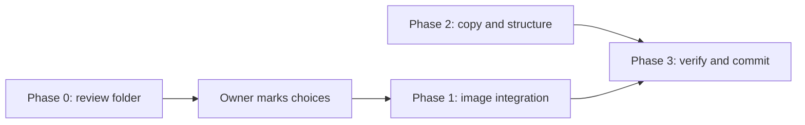

# House of Kani — Website Transformation Plan

This plan merges two pieces of work:

- the product and content audit in [docs/product-content-audit.md](product-content-audit.md);
- a fresh review of the generated images in `~/Downloads/THE KASHMIR WEAVER/PRODUCTS/GENERATED/`.

Raw camera and WhatsApp photos are out of scope.

## 1. Locked decisions

- **Business:** a 4th-generation Kashmiri family business. It owns looms and also curates from a trusted artisan network. The family is now taking the brand online.
- **Offer:** 100% pure Pashmina shawls, stoles and wraps. Techniques are Kani, Sozni, Maheen Kari (fine needlework) and solids or checks.
- **GI:** pieces are GI-eligible. GI labelling is arranged when a customer asks for it.
- **Services that are real:** an office in Srinagar, loom visits, and scheduled appointments in person or online.
- **Sales channel:** Etsy first, and it is the brand's public face. Contact details and the Etsy URL stay as clearly marked placeholders until they are supplied.
- **The Kashmir Weaver:** never named on the site. Only product facts are reused (pure Pashmina, handwoven, dry clean only). SKUs, prices, vendor names and anything carrying that branding stay off.
- **Images:**
  - Product slots get generated images of the real pieces.
  - Non-product slots stay as they are: loom, fibre, workshop, Kashmir landscapes, archive, gardens and ornament.
  - The hero is chosen by the owner from a review folder (Phase 0).
- **Never publish:** the cost prices in Series 2 `details.txt` files.

## 2. Generated image review (447 images)

| Folder | Count reviewed | Size (px) | Watermark | Verdict |
|---|---|---|---|---|
| `All`, files 1–44 only | 44 | 768x1376 (two PNGs differ) | Sparkle on the warm-interior batch | Victorian-salon and dark-studio shots are clean and match the site's mood, but they are too small for full-bleed use. Card use only. |
| `MUDASIR/Series 1/KANI` (15 pieces + POMELI A–H) | 152 | 1792x2400, 2048x2048, 922x1152, 768x1365 | None | Best source for the hero and large sections. All pieces are Kani according to `product.txt`. |
| `MUDASIR/Series 2/Archive.zip` (32 groups) | 157 | 922x1152 | None | Best source for Sozni and Maheen Kari product cards. Each piece has a consistent set: flat lay, studio model and lifestyle. |
| `MUDASIR/Series 3/Shawls` (21 pieces) | 30 | 1792x2400 | Sparkle on every image | Large and consistent, but bright and modern in mood. A crop is needed on every image. No technique labels. |
| `AZHAR/KANI` (16 pieces) | 64 | 768x1365 | None | Shots 1–3 of each piece work as Kani cards. Shot 4 is always a Valentine or July 4th set. |

**Series 2 technique labels** (from `details.txt`):

| Technique | Folders |
|---|---|
| Sozni | `0716 (1)`, `(2)`, `(4)`, `(6)`, `(7)`, `(8)`; `0717`, `0717 (1)`, `(3)`–`(12)` |
| Maheen Kari | `1`, `2`, `0716`, `0717 (13)`–`(17)` |
| Kani | `0716 (3)` |
| Sozni with Kani fusion | `0717 (2)` |
| Checker, 3 yards, reversible | `0716 (5)` |

**Rejected:**

| Images | Reason |
|---|---|
| `All` #43 (`file_…013081…png`) | A website design mock-up, not a product |
| AZHAR shot 4 of every piece | Seasonal props (hearts, stars) |
| Series 1 folder 1 gift-box shots (`Pashmina_shawl_and_gift_box_*`) | The box shows "Kashmir Weaver" branding |
| Series 1 folder 8 | The generated fabric is distorted (finding from the earlier review) |
| Series 1 folder 11 `WhatsApp*` files; Series 2 `Raw/` and `Products/Checkers` | Raw photos |
| `All` 2, 10, 27, 40; Series 2 `Products/Maheen Kari/*` and `0717 2` | Exact duplicates of other images |

**Gap: solids.** No generated set shows a plain solid. The only solid-type piece is the reversible checker, `0716 (5)`. The owner must choose one of two options for the Solids slot: the checker, or keeping the current `original-solid-pashmina.jpg`.

## 3. Current slot map

The registry is `src/lib/images.ts`. Four registry entries point to byte-identical files: `kaniPattern`, `craftsmanshipHall`, `privateClient` and `closingDrape`. The loom image (3 file names) and the fibre image (2 file names) are also duplicated.

| Slot | Used on | Type | Action |
|---|---|---|---|
| `victorianKaniHero` | Home hero, `/pashmina`, `/the-house`, OG image | Product | Replace with the owner's hero pick. Give each page its own image. |
| `kaniPattern` | Home Kani card, `/pashmina`, `/heritage`, `/kani` | Product | Kani candidate from Series 1 or AZHAR |
| `originalSozni` | Home Sozni card, `/pashmina` (twice) | Product | Sozni candidate from Series 2 |
| `originalSolid` | Home Solids card, `/pashmina` | Product | Checker or keep (owner decides) |
| `craftsmanshipHall` | `/heritage`, `/kani`, `/private-client`, `/stockists`, `/the-house` | Product | Split into distinct product images per page |
| `privateClient` | `/private-client` | Product | Appointment-style image (studio model) |
| `closingDrape` | Home closing band | Product | Wide crop of a Series 1 drape on a walnut rod |
| `heroHome` | `/press` | Product | Not needed while Press is parked |
| All other slots | | Non-product | Keep. Reduce repeats within a single page journey. |

## 4. Phases

Phase 2 does not depend on the image choices, so it can run alongside the owner's review.

### Phase 0 — Review folder (needs agent mode)

Create `review/` at the repo root and add `review/` to `.gitignore`. This keeps hundreds of MB of originals out of the branch that syncs to Lovable. Originals are copied, never moved.

Each image is named `<ID>_<source>_<description>_<WxH>.<ext>`, for example `H03_S1-13_saffron-kani-rod-dark_1792x2400.jpeg`.

**`review/01-hero/`**

| ID | Source | What it shows |
|---|---|---|
| H00 | Current `victorian-kani-hero-wide.jpg` | Baseline for comparison |
| H01 | Series 1 folder 11 `Product_in_dark_studio` | Olive shawl with embroidered border on a form, dark background |
| H02 | Series 1 folder 11 `Generate_different_angle` | Olive shawl on a rod, dark background |
| H03 | Series 1 folder 13 `Yellow_floral…2026` | Saffron Kani on a rod, dark background |
| H04 | Series 1 folder 13 `Shawl_photo_shoot_dark_studio` | Saffron Kani draped, dark background |
| H05 | Series 1 folder 7 `Generate_hero_image_product_shoot` | Royal blue Kani drape |
| H06 | Series 1 folder 10 `Drape_over_walnut_rod (1)` | Floral butti on a walnut rod, dark background |
| H07 | Series 1 folder 9 `Drape_over_polished_walnut_rod` | Oatmeal Kani on a rod, dark background |
| H08 | Series 1 folder 1 `Model_walking_in_studio` | Model-led shot, purple stripe Kani |
| H09 | Series 1 folder 1 `Handwoven…diam` (2048x2048) | Weave close-up, for a detail-led hero |
| H10 | Series 3, three picks (S3, S9, S10) | Lighter, modern direction. Watermark crop needed. |
| M-refs | `All` 1, 35, 36, 39 | Victorian mood references only. Too small for the hero. |

**Other folders**

| Folder | Candidates |
|---|---|
| `02-kani/` | Series 1 folders 1, 7 and 13; AZHAR pieces 4, 9, 11 and 14 (shots 1–2) |
| `03-sozni/` | Series 2 `0716 (2)`, `0717 (4)`, `0717 (12)`, `0717 (1)` and `0716 (8)` (flat lay plus studio) |
| `04-maheen-kari/` | Series 2 `0716`, `0717 (15)`, `0717 (16)` and `0717 (17)` |
| `05-solids/` | Series 2 `0716 (5)` checker, and the current `original-solid-pashmina.jpg` |
| `06-closing-and-appointments/` | Series 1 folder 11 rod drapes on a light background; Series 1 folder 1 seated-on-plinth; Series 2 `0717 (13)` arches |
| `07-pieces-catalogue/` | One cover shot per piece for an informational catalogue: Series 1 (14 pieces), Series 2 (28), AZHAR (16) |

Inside `review/`:

- a `contact-sheet.jpg` in each folder;
- a `review/README.md` with one table per folder. Columns: ID, source path, size, watermark, proposed slot, notes, and an empty **Decision** column for the owner (use / maybe / no).

Open questions for the owner go at the top of `review/README.md`:

1. Which hero (H00–H10)?
2. Solids: the checker, or keep the current image?
3. Technique labels for Series 3 and `All` pieces, which have no notes.
4. Is "Maheen Kari" the public name, or should the site say "fine Sozni (Maheen Kari)"?
5. Should a short note say that product images are styled renderings matched to the real piece?

### Phase 1 — Image integration (after the owner marks choices)

- Export the chosen originals to `public/images/` as JPG masters, matching commit `c6fba68`:
  - crop the sparkle watermark from any Series 3 or `All` image used;
  - make landscape crops for wide slots;
  - give files descriptive names, such as `kani-saffron-rod.jpg`.
- Update `src/lib/images.ts`:
  - add the new product keys;
  - give each page its own image, ending the 4-way duplicate;
  - fix the stale "AVIF/WebP" comment.
- Add `src/lib/pieces.ts`, a typed local module as required by `AGENTS.md`. Fields: id, name, technique, form, fibre ("100% pure Pashmina"), GI-on-request flag, images and alt text. No prices or SKUs.
- Rewrite all alt text to describe the actual piece. Remove "archival", "candlelight" and other inaccurate wording.

### Phase 2 — Copy and structure (audit Top 10, using the confirmed facts)

1. **Home hero** (`src/app/page.tsx`): a plain value proposition (a family house of pure Kashmiri Pashmina, 4th generation, Srinagar) and one main action. Keep the tagline visible on mobile.
2. **Define Pashmina:**
   - add a short definition on the homepage;
   - restructure `/pashmina` to lead with the material: what it is, where it comes from, how it compares with cashmere and wool, pure versus blend, hand versus machine;
   - then give each technique equal depth, adding Maheen Kari and the fusion piece.
3. **The House** (`src/app/the-house/page.tsx`): the identity page. Cover the four generations, own looms plus a curated network, the Srinagar office and loom visits. No invented names.
4. **Authenticity and GI:** a new section, or `/authenticity`. Cover what "pure" means here, what is disclosed per piece, and GI labelling on request.
5. **Pieces:** a non-commerce catalogue section or route built from `pieces.ts`. Each piece links to Etsy using the placeholder URL.
6. **Where to buy:** replace `/stockists` with an honest page about Etsy-first. Link Etsy from the header, footer and home band, replacing the current unlinked text.
7. **Appointments:** rework `/private-client` around the real service (in-person Srinagar or online, loom visits). Remove the London salons and "appointed partners".
8. **Trust fixes:**
   - placeholders in `src/lib/site.ts` stay, clearly labelled, and are removed from `organizationLd` until real;
   - social links set to `#` are hidden;
   - `EnquiryForm` either becomes honest (a `mailto:` link or a clear "not yet active" message) or is hidden;
   - `/press` is parked.
9. **De-poeticise:** keep at most one aphorism per section; replace the rest with facts. Rebalance Kani-only framing on `/heritage`, `/kashmir` and `/private-client`.
10. **Journal** (`src/lib/journal.ts`): read times calculated from word count; remove the empty "Heritage" filter; remove the unnamed-interview framing. Longer articles come later.

Also consolidate the overlap between `/heritage` and `/kashmir`, and add Kani to the header navigation. Update `sitemap.ts` for added, parked and renamed routes.

### Phase 3 — Verify and commit

- Run `npm run lint`, then `npm run build`.
- Check every route on desktop and mobile widths.
- Grep for "Kashmir Weaver", "MK", prices and `href="#"`.
- Make focused conventional commits (`feat:`, `fix:`, `refactor:`). Do not push until the owner approves, because the branch syncs to Lovable.
